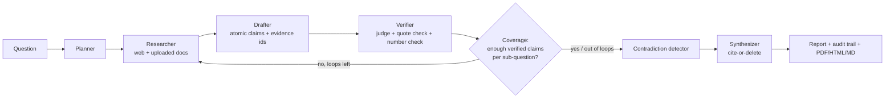

# 🔎 Verified Research: a multi-agent system whose citations are checked

Ask a research question. Specialized agents plan, gather real evidence, draft claims, and then an **adversarial
verifier checks every claim against the exact source it cites**. Unsupported claims are rejected, thinly
supported sub-questions trigger **another research round**, and the final report contains only sentences that
trace to retrieved sources. Every step is logged.

All LLM calls go through **Mesh API** (OpenAI-compatible gateway) via the OpenAI SDK (`vresearch/llm.py`).

## Architecture



| Agent | Own job | Own prompt/tools |
|---|---|---|
| Planner | question → 4-6 sub-questions + queries | planner prompt |
| Researcher | search (DuckDuckGo, Wikipedia fallback), fetch pages, rank passages (BM25), search uploaded PDFs/TXT; on loop-back, writes *new* queries | search/fetch tools, refine prompt |
| Drafter | evidence → atomic claims citing evidence ids | drafter prompt |
| Verifier | judges (claim, cited passages) → supported / partial / unsupported | adversarial verifier prompt (+ optional separate model) |
| Contradiction detector | finds verified claims that disagree | contradiction prompt |
| Synthesizer | writes report from verified claims only | synthesizer prompt |

Orchestration is a **LangGraph** `StateGraph` (`vresearch/pipeline.py`) with a real conditional edge from
`coverage` back to `research`.

## How grounding is enforced (not just prompted)

1. **Evidence store**: every passage is saved with URL, title, source-quality weight (SQLite `evidence` table).
2. **Verifier** returns a verdict *and a verbatim quote*. Code then checks the quote really occurs in a cited
   passage and that every number in the claim appears in the cited text. A "supported" verdict failing either
   check is downgraded to *unverified*.
3. **Statuses**: `verified` (used), `unverified` (shown only with an "(unverified)" tag), `rejected` (never shown, logged with reason).
4. **Cite-or-delete**: the synthesizer must cite claim ids; any sentence without a valid citation is deleted
   (count recorded as `uncited_sentences_dropped`). `[C3]` is rewritten to numbered sources `[1]`.
5. **Loop-back**: a sub-question with fewer than `MIN_VERIFIED_PER_SUBQ` verified claims is researched again
   with new queries, up to `MAX_LOOPS`. If still thin, the report says so instead of padding.

Bonus features: **contradiction detection** (flagged in the report, with the higher-quality source noted),
**source-quality weighting** (`vresearch/source_quality.py`: primary > reputable press > general > blogs/forums;
used to rank pages, order evidence and break contradiction ties), **PDF / HTML / Markdown export**, and a
**follow-up chat** that answers only from the run's verified claims.

## The website

A single-page FastAPI site (`server.py`, `web/index.html`). The hero search card streams the run live over SSE:
a five-stage tracker (Planner → Researcher → Drafter → Verifier → Synthesizer), claim cards with source chips
(✓ verified, ? unverified, rejected claims struck through with the reason), a live run log, and a visible
"searching again" hint on loop-back. The report below offers PDF, shareable HTML and Markdown, each with the
accepted/unverified/rejected audit appendix. With no `MESH_API_KEY` (or via "see a sample run") it replays a
recorded sample, clearly labelled as illustrative. Live runs are rate-limited (30 s per IP, 2 concurrent).

## Run locally

```bash
python -m venv .venv && source .venv/bin/activate
pip install -r requirements.txt
cp .env.example .env        # put your rsk_ key in MESH_API_KEY
uvicorn server:app --reload --port 7860
```

Offline tests (no API key or internet; scripted fake LLM + fake search drive the real graph):

```bash
python -m pytest -q
```

## Deploy for free

**Hugging Face Spaces (recommended, free CPU):** create a Space → SDK **Docker** → push this repo
(the README front matter above is already the Space config) → *Settings → Variables and secrets* → add secret
`MESH_API_KEY`. Done; the app listens on port 7860.

**Render (free web service):** New → Blueprint → select the repo (`render.yaml` included) → set `MESH_API_KEY`.

**Docker anywhere:** `docker build -t vr . && docker run -p 7860:7860 -e MESH_API_KEY=rsk_... vr`

Cost control: search and page fetching are free. LLM cost is a handful of calls per sub-question plus one call per
claim for verification; pick a free or cheap Mesh model via `MESH_MODEL`. Free hosts have ephemeral disk, so
saved runs reset on restart; exports are the durable artifact.

## Self-evaluation

`python -m evaluation.run_eval [--judge-model <different model>]` runs 8 questions (7 real, 1 adversarial
"unanswerable" case) and writes `results/eval_results.md|json`. Metrics: groundedness (verified / drafted),
quote-grounded rate (programmatic), coverage after loop-backs, topic recall (completeness proxy), and optional
**independent agreement** from a different judge model on a sample of accepted claims.

Results: **run the command above with your key and paste the table here** (`results/eval_results.md`).
The numbers are produced by the code and must not be edited by hand. Pytest results (offline, scripted):
8 passed, covering loop-back, claim rejection, number/quote checks, cite-or-delete, contradictions, follow-up, exports.

## Key design decisions

- **Verifier ≠ drafter**: separate prompt, and a separate model is configurable (`MESH_VERIFIER_MODEL`) to reduce self-agreement.
- **Judge plus code**: LLM verdicts are cross-checked with deterministic quote and number checks, because LLM judges can be lenient.
- **BM25 not embeddings**: passage ranking costs nothing and has no extra dependency; swap in Mesh embeddings if desired.
- **Free search**: DuckDuckGo via `ddgs` with Wikipedia fallback; no keys. Search quality is the main limit; add a search API in `vresearch/search.py` if needed.
- **Honest limits**: the verifier only checks a claim against its *cited* passages; it does not prove the source itself is true. Page extraction can miss paywalled or JS-heavy sites.

## Layout

```
server.py              FastAPI app (SSE stream, exports)
web/                   index.html, sample_run.json
vresearch/             agents.py, pipeline.py (LangGraph), llm.py (Mesh), search.py, ingest.py,
                       source_quality.py, report.py, export.py, store.py (SQLite audit trail)
evaluation/            questions.json, run_eval.py
tests/                 offline end-to-end tests
Dockerfile, render.yaml, .env.example
```
