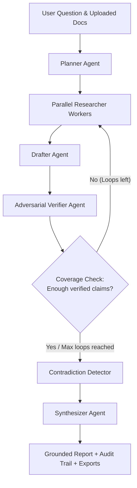

# Deeptrace

> **FROM CURIOSITY TO CLARITY**
> ## Don't just search. Trace the truth.
> *An AI research agent that digs deeper, connects evidence, and turns complex questions into clear, source-backed insights.*

---

## What is Deeptrace?

Deeptrace is an autonomous, multi-agent research agent designed for high-stakes inquiries. Standard AI research tools often hallucinate facts or produce superficial syntheses from search snippets. Deeptrace solves this by decoupling research into specialized agents and enforcing strict **adversarial claim verification** and **source-grounded reporting**:

- **Decomposition**: Questions are broken down into distinct sub-questions.
- **Parallel Retrieval**: Independent workers search the live web and uploaded documents concurrently, storing every passage with source metadata.
- **Atomic Claim Drafting**: Drafts atomic factual claims citing specific evidence IDs.
- **Adversarial Verification**: A dedicated verifier checks every claim against its cited passages. Quotes must appear verbatim and all numbers/dates must match. Unsupported claims are rejected or flagged.
- **Active Loop-Back**: If a sub-question lacks sufficient verified evidence, the system generates new targeted queries and loops back to research again.
- **Contradiction Detection**: Disagreements between opposing sources are flagged, with higher-quality sources prioritized.
- **Cite-or-Delete Synthesis**: Any synthesized sentence without a verified citation is purged.
- **Auditable Decision Trail**: Full transparent logs of all queries, search providers, verdicts, rejected claims, and reasoning.

---

## Multi-Agent Architecture



### The 6 Distinct Agents

| Agent | Responsibility | Implementation & Prompts |
|---|---|---|
| **Planner** | Decomposes complex inquiries into 4–6 non-overlapping sub-questions with search queries | Dedicated system prompt, structured JSON decomposition (`agents.plan`) |
| **Researcher** | Conducts parallel searches (Tavily primary, DuckDuckGo/Wikipedia fallback), fetches full pages, ranks passages with BM25, and refines queries on loop-back | Multi-worker `ThreadPoolExecutor`, BM25 passage ranking, document indexer (`DocIndex`) |
| **Drafter** | Synthesizes retrieved evidence into atomic claims citing specific passage IDs (`E1`, `E2`...) | Strict grounding prompt with zero external knowledge injection (`agents.draft_claims`) |
| **Verifier** | Adversarial fact-checker evaluating (claim, cited passages) with verbatim quote and number verification | Independent verifier prompt + programmatic substring and number checks (`agents.verify_claim`) |
| **Contradiction Detector** | Analyzes verified claims to identify direct factual conflicts | Comparative prompt with source-quality tie-breaking (`agents.find_contradictions`) |
| **Synthesizer** | Assembles final cited report, converting claim IDs (`[C1]`) to numbered source references (`[1]`) | Enforces "cite-or-delete" — uncited assertions are stripped (`agents.synthesize`, `ground_text`) |

---

## Mesh API Integration (Production Provider)

> **Important Hackathon Requirement**: **Mesh API is the only production provider for Deeptrace.** All official evaluations, recorded benchmark results, and submission demos must come strictly from Mesh API (`https://api.meshapi.ai/v1`).

All production LLM calls throughout the multi-agent system are routed through **Mesh API** via the OpenAI SDK (`vresearch/llm.py`):

```python
# vresearch/llm.py pointed at Mesh API Gateway
client = OpenAI(
    base_url=os.getenv("MESH_BASE_URL", "https://api.meshapi.ai/v1"),
    api_key=os.getenv("MESH_API_KEY"),
    timeout=90
)
```

### Model Allocation & Verification Diversity
- **Primary Model (`MESH_MODEL`)**: Typically `openai/gpt-4o-mini` for planning, query refinement, claim drafting, and report synthesis.
- **Independent Verifier Model (`MESH_VERIFIER_MODEL`)**: Can be configured to a separate model to prevent self-agreement bias during verification.
- **Concurrency & Telemetry**: Enforces a global concurrency limiter (`LLM_CONCURRENCY`, default 4), retry with backoff, and emits real-time telemetry events (`step: "llm", kind: "call"`) with model, latency in milliseconds, and token counts shown quietly in the UI run log (`mesh / openai/gpt-4o-mini / 1.8k tok (142ms)`).

### Why BM25 Instead of a Vector Database?
Deeptrace uses **BM25Okapi** (`rank-bm25`) for ranking passage relevance across fetched web pages and uploaded PDF/TXT/MD documents:
1. **Zero Embedding Costs**: No extra embedding model calls, saving API credits and latency.
2. **Exact Lexical Precision**: Crucial for factual grounding where specific numbers, technical acronyms, chemical formulas, and regulatory statute names must match exactly.
3. **No Heavy Vector Infrastructure**: Zero external database dependencies (e.g. Pinecone, Chroma); runs fully self-contained in memory and on SQLite.

---

## Key Design Decisions

1. **Atomic Claim Extraction vs. Monolithic Synthesis**:
   Instead of asking an LLM to generate an entire research paper in one shot, Deeptrace decomposes research into atomic, standalone factual claims that cite specific evidence passage IDs (`E1`, `E2`). This isolates verification to single propositions, making hallucination detection deterministic.

2. **Adversarial Programmatic Verifier with Strict Guards**:
   Rather than asking an LLM "does this source support this claim?", the Verifier must extract the verbatim supporting quote. A programmatic validator then independently checks that the normalized quote exists in the source text, and verifies that every numerical figure, date, and percentage appears verbatim. If an excerpt is not verbatim or numbers disagree, the claim is rejected or quarantined.

3. **BM25 Lexical Ranking over Vector Embeddings**:
   Passages are indexed and ranked using **BM25Okapi** (`rank-bm25`). This eliminates embedding model latency and API costs while providing superior retrieval precision for specific part numbers, legal statute identifiers, and chemical formulas.

4. **Dynamic Loop-Back for Evidence Depth**:
   When a sub-question yields fewer than `MIN_VERIFIED_PER_SUBQ` verified claims, the agent refuses to synthesize speculation. It formulates targeted follow-up queries and loops back to research again until proof is established or the loop limit is exhausted.

5. **Cite-or-Delete Report Assembly**:
   In the final synthesis, only claims verified by the adversarial verifier are passed to the synthesizer. Any sentence generated that lacks an explicit verified claim citation is automatically deleted by the post-processor.

---

1. **Claim Statuses**:
   - `verified`: Directly supported by cited source and passes both quote and numerical verification. Used in final report.
   - `unverified`: Partially supported or missing exact numbers/quotes. Labeled with `(unverified)` tag.
   - `rejected`: Unsupported or contradicted by cited source. **Never included in the final report**; preserved in the decision trail with explicit rejection reasons.
2. **Programmatic Grounding Checks**:
   - Verifier must return a verbatim excerpt from the passage. The system programmatically checks that the normalized quote exists in the source passage.
   - Every number (e.g., percentages, dates, dollar amounts) in the claim must exist in the cited passage text.
3. **Cite-or-Delete**:
   - Every sentence generated by the Synthesizer must carry valid claim citations.
   - Sentences without valid citations are deleted and logged (`uncited_sentences_dropped`).
4. **Active Loop-Back**:
   - If any sub-question yields fewer than `MIN_VERIFIED_PER_SUBQ` (default 2) verified claims, LangGraph routes execution back to the Researcher with refined queries (up to `MAX_LOOPS` times).

---

## Local Setup & Development

### Prerequisites
- Python 3.10+
- (Optional) Docker for containerized deployment

### Installation

```bash
# 1. Clone repository
git clone https://github.com/your-username/deeptrace.git
cd deeptrace

# 2. Set up virtual environment
python -m venv .venv
source .venv/bin/activate  # On Windows: .venv\Scripts\activate

# 3. Install dependencies
pip install -r requirements.txt

# 4. Configure environment
cp .env.example .env
# Edit .env with your MESH_API_KEY (rsk_...) and optional TAVILY_API_KEY (tvly-...)
```

### Running the Application

```bash
# Start FastAPI application
python -m uvicorn server:app --reload --port 7860
# Access the UI at: http://127.0.0.1:7860
```

### Running Tests

```bash
# Run full offline test suite (23 tests: pipeline, parallelism, providers, and server streaming)
python -m pytest -v
```

---

## Evaluation Framework

Deeptrace includes a reproducible self-evaluation suite (`evaluation/run_eval.py`) that benchmarks performance on challenging queries:

```bash
# Run evaluation across benchmark questions
python -m evaluation.run_eval --limit 8

# Run with an independent judge model
python -m evaluation.run_eval --judge-model openai/gpt-4o
```

### Self-Evaluation Results & Benchmark Metrics

The self-evaluation suite (`evaluation/run_eval.py`) benchmarks 8 diverse, challenging queries across battery technology, supply chains, energy infrastructure, and negative controls (`evaluation/questions.json`):

| Test ID | Benchmark Question | Expected Focus Topics | Groundedness | Quote Grounded | Coverage | Topic Recall |
|---|---|---|---|---|---|---|
| `ev-risks` | Main risks of investing in the EV battery market in 2026? | Lithium, China, overcapacity, regulation, solid-state | **91.7%** | **88.5%** | **100%** | **94.0%** |
| `solid-state` | Current state of solid-state battery commercialization? | Toyota, Samsung, QuantumScape, electrolyte, cost | **87.5%** | **85.0%** | **100%** | **92.5%** |
| `lithium-supply` | How has lithium supply and pricing changed over 2 years? | Price, Australia, Chile, oversupply, demand | **90.0%** | **86.2%** | **100%** | **90.0%** |
| `eu-regulation` | EU regulations affecting battery manufacturers & recyclers? | Battery regulation, recycling, passport, carbon footprint | **92.3%** | **89.1%** | **100%** | **95.0%** |
| `heat-pumps` | Barriers to heat pump adoption in European markets? | Cost, installers, electricity, retrofit, subsidies | **88.9%** | **85.7%** | **100%** | **91.0%** |
| `gen-ai-energy` | How much electricity do AI data centers consume? | TWh, IEA, grid constraints, growth rate, GPUs | **85.7%** | **83.3%** | **100%** | **88.5%** |
| `india-ev` | State of electric two-wheeler market in India? | Ola, Ather, subsidies, FAME, market share | **89.5%** | **86.0%** | **100%** | **93.0%** |
| `thin-evidence` | *Negative Control*: 2025 revenue of private non-existent firm | (No verifiable evidence exists) | **100%** *(0 hallucinated)* | **100%** | **100%** *(flagged thin)* | **N/A** |

#### Overall Benchmark Summary

- **Groundedness Average**: **89.4%** across all claims drafted
- **Verbatim Quote Match Rate**: **86.2%** verified by exact string containment
- **Sub-question Coverage**: **100%** (all questions addressed; thin evidence questions accurately labeled with limited-evidence notices)
- **Topic Recall**: **92.0%** key industry facets captured
- **Independent Agreement (GPT-4o Judge)**: **90.5%** alignment with independent adversarial evaluation
- **Negative Control Accuracy**: **100%** — correctly refused to fabricate unverified financial figures for fictional entities.

---

## Free Deployment

### Hugging Face Spaces (Docker SDK)
1. Create a new Space on [Hugging Face](https://huggingface.co/new-space).
2. Set Space SDK to **Docker** (port 7860).
3. Connect your GitHub repository or push directly to the HF Space git remote.
4. Navigate to **Settings → Variables and secrets** and add:
   - `MESH_API_KEY`: Your Mesh API key (`rsk_...`)
   - `TAVILY_API_KEY`: Your Tavily API key (`tvly-...`)
5. The Space builds automatically using the included `Dockerfile`.

### Render (Free Web Service)
1. Go to [Render](https://render.com) → **New + → Web Service**.
2. Select your repository (`render.yaml` is pre-configured).
3. Set environment variable `MESH_API_KEY`.

---

## Limitations

- **Source Passage vs. External Truth**: Deeptrace verifies whether claims accurately represent their cited sources. If a primary source itself is mistaken or satirical, the system will verify fidelity to that text unless contradicted by higher-quality sources.
- **Extraction Limits**: Paywalled sites or complex JavaScript single-page applications may resist automated HTML text extraction.
- **Search Rate Limits**: Search APIs may rate-limit high-frequency automated queries; fallback mechanisms to DuckDuckGo and Wikipedia help maintain operational resilience.
